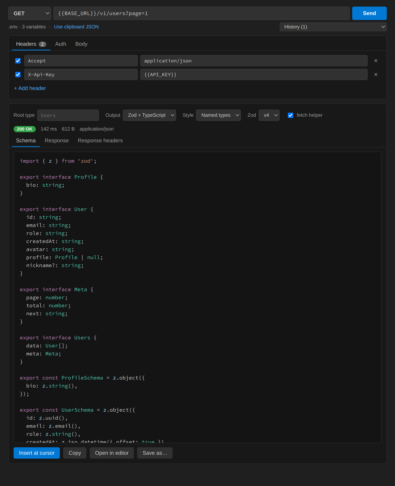

# ResponseToSchema: API → Zod & TypeScript

**Hit an endpoint, get types.** Send a real HTTP request from inside VS Code and instantly get a TypeScript interface **and** a matching Zod schema generated from the JSON response, with no copy-pasting between Postman, a converter website and your editor.



## Why

Typing API responses by hand is slow and drifts out of date. The usual workflow is three tools: an HTTP client to call the API, a website to convert JSON to types, and your editor. ResponseToSchema does all of it in one panel, locally:

- **Request → types in one click.** Method, URL, headers, auth and body, then Send. The response becomes `interface User` + `UserSchema` on the spot.
- **Paste a cURL, get everything.** Paste a "Copy as cURL" command from browser dev tools or API docs into the URL bar. Headers, body, method and auth are filled in for you.
- **Correct Zod 4 (and Zod 3).** Emits modern Zod 4 APIs (`z.email()`, `z.iso.datetime()`, `z.uuid()`), or Zod 3 syntax if your project hasn't upgraded.
- **Real inference, not first-element guessing.** Every array element is merged: keys missing from some items become optional (`?` / `.optional()`), `null` becomes `| null` / `.nullable()`, and mixed types become unions.
- **Readable output.** Nested objects are hoisted into named types (`Address`, `OrderItem`), and identical shapes are de-duplicated. Root names come from the URL (`/v1/users/42` → `User`).
- **Typed fetch helper.** Optionally generate a `fetchUsers()` function that calls the endpoint and validates the response with the schema.
- **Secrets stay put.** `{{API_KEY}}` placeholders are resolved from your workspace `.env`. Literal tokens are never written to request history. Nothing leaves your machine except the request you send.

## Features

### Request panel
`ResponseToSchema: Open Request Panel` from the Command Palette.

| | |
|---|---|
| Methods | GET, POST, PUT, PATCH, DELETE, HEAD, OPTIONS |
| Auth | Bearer token, Basic auth (UTF-8 safe) |
| Variables | `{{NAME}}` in URL, headers, auth and body, from `.env` (configurable). Unresolved variables are reported before sending. |
| cURL import | `-X`, `-H`, `-d`/`--data-*`, `--json`, `-u`, `-b`, `-A`, `-G`, `--url`, line continuations, `$'…'` strings |
| Response | Status, time, size, pretty-printed body, response headers |
| Output | Zod + TypeScript, Zod only (with `z.infer` types), or TypeScript only; named or inline; Zod 4 or 3 |
| Actions | Insert at cursor, Copy, Open in editor, Save as file |
| History | Last 50 requests per workspace, secrets redacted |

Shortcut: **Ctrl/Cmd + Enter** sends the request.

### No API call needed
- **Paste JSON as Zod & TypeScript:** in a `.ts` file, run the command (or use the right-click menu) and the clipboard JSON is converted at your cursor. If the file already imports `zod`, the import isn't duplicated.
- **Generate from JSON selection / file:** right-click a JSON selection, a `.json` editor, or a `.json` file in the Explorer.
- **Use clipboard JSON** in the request panel.

### Example

```json
{ "data": [ { "id": "9b2f…", "email": "ada@example.com", "profile": null },
            { "id": "1c2f…", "email": "bob@example.org", "profile": { "bio": "hi" }, "nickname": "bobby" } ] }
```

becomes

```ts
export interface Profile { bio: string; }

export interface User {
  id: string;
  email: string;
  profile: Profile | null;
  nickname?: string;
}

export interface Users { data: User[]; }

export const ProfileSchema = z.object({ bio: z.string() });

export const UserSchema = z.object({
  id: z.uuid(),
  email: z.email(),
  profile: ProfileSchema.nullable(),
  nickname: z.string().optional(),
});

export const UsersSchema = z.object({ data: z.array(UserSchema) });
```

## Settings

| Setting | Default | |
|---|---|---|
| `responseToSchema.outputMode` | `combined` | `combined`, `zod`, or `typescript` |
| `responseToSchema.zodVersion` | `4` | `4` or `3` |
| `responseToSchema.typeStyle` | `named` | `named` hoists nested objects; `inline` keeps one declaration |
| `responseToSchema.detectFormats` | `true` | ISO datetime/date, email, UUID, URL validators |
| `responseToSchema.detectIntegers` | `false` | `z.number().int()` when all samples are whole numbers |
| `responseToSchema.includeFetcher` | `false` | Append a typed, validating `fetchX()` helper |
| `responseToSchema.indentation` | `2` | `2`, `4`, or `tab` |
| `responseToSchema.envFile` | `.env` | Variables file, relative to the workspace folder |
| `responseToSchema.requestTimeoutSeconds` | `30` | |
| `responseToSchema.arraySampleLimit` | `1000` | Max array elements inspected (0 = all) |
| `responseToSchema.history.maxEntries` | `50` | 0 disables history |

## How inference works

- Formats are only applied when **every** sample matches, so a field that is sometimes `""` stays `z.string()`.
- Integers are opt-in, because one sample can't tell `10` from `10.5`.
- Empty arrays become `unknown[]`. Empty objects become `Record<string, unknown>` / `z.record(z.string(), z.unknown())`.
- Keys that aren't valid identifiers are quoted (`"Content-Type": string`).

Every release is tested by running the generated schemas against their source JSON with real Zod 4 and Zod 3, and typechecking the generated TypeScript against that JSON.

## Privacy

Requests are sent from the VS Code extension host directly to the URL you enter. There is no telemetry and no account, and there are no third-party servers. Request history lives in VS Code workspace storage; auth tokens, passwords and sensitive headers (`Authorization`, `Cookie`, `*token*`, `*api-key*`, …) are blanked unless they are `{{VARIABLE}}` placeholders.

## Known limitations

- Requests use Node's `fetch`, so VS Code's `http.proxy` setting and self-signed certificates may not be honored on older VS Code versions.
- `multipart/form-data` bodies and file uploads aren't supported yet.
- Discriminated unions (e.g. events keyed by `type`) are merged into one object with optional fields.

## Contributing

```bash
npm install
npm run check        # typecheck + unit/round-trip tests + extension host smoke test
npm run watch        # then press F5 to launch an Extension Development Host
npm run package      # builds response-to-schema-<version>.vsix
```

Issues and PRs welcome at [github.com/murtaza335/ResponseToSchema](https://github.com/murtaza335/ResponseToSchema).

## License

MIT
